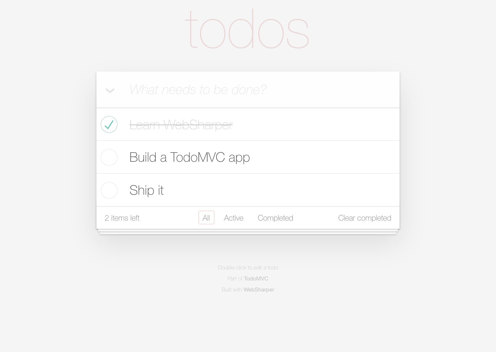

# TodoMVC with WebSharper UI

A [TodoMVC](https://todomvc.com/) implementation built with
[WebSharper](https://websharper.com) and WebSharper.UI — a reactive
[`ListModel`](https://websharper.com) of entries with hash routing for the
All / Active / Completed filters.

[](https://websharper-samples.github.io/TodoMVC)

**[Try it live](https://websharper-samples.github.io/TodoMVC)**

## What it shows

- A reactive `ListModel<int, TodoItem>` rendered with `Doc.BindListModelLens`,
  so individual entries update without re-rendering the list.
- Per-entry toggling, inline editing (double-click), and removal.
- Filtering via `RouteMap` and hash routing (`#`, `#active`, `#completed`).
- A single HTML template (`src/wwwroot/index.html`) loaded with
  `ClientLoad.FromDocument` and bound with `.Bind()`.

For the Model-View-Update take on the same app, see the
[WebSharper.Mvu TodoMVC](https://websharper-samples.github.io/Mvu).

## Running locally

```
dotnet run --project src
```

Then open <http://localhost:5280>.

## Building

```
dotnet build src/TodoMVC.fsproj -c Release
```

WebSharper compiles the client and [esbuild](https://esbuild.github.io/) bundles
it into `src/wwwroot/Scripts` for Release.

## Deployment

Every push to `master` builds in Release and publishes `src/wwwroot` to the
`gh-pages` branch via `.github/workflows/deploy.yml`.
